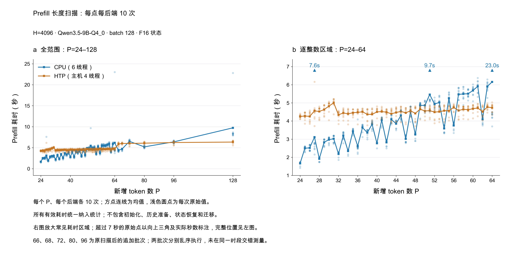
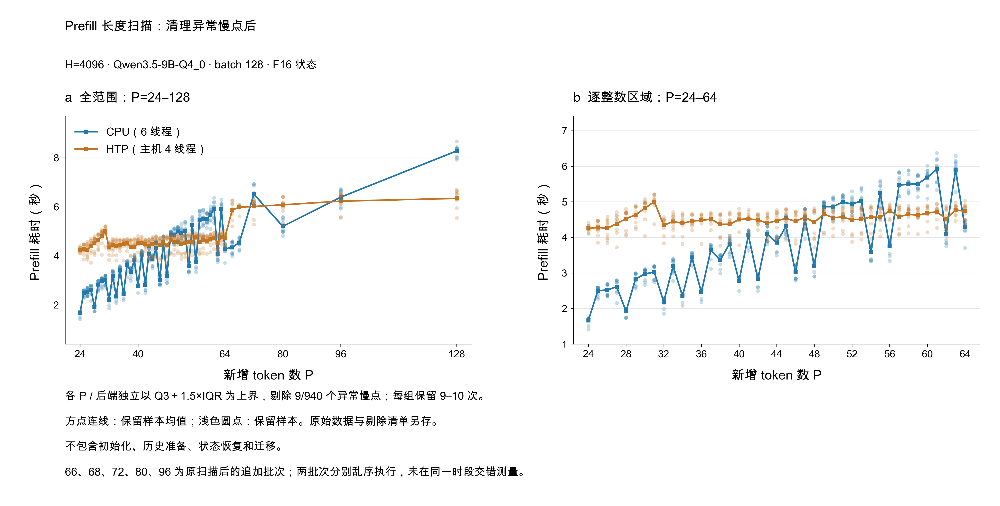

# CPU Prefill 锯齿：列切块与双行内核回退

## 完整实验与数据

最详尽扫描固定H=4096、Qwen3.5-9B-Q4_0、8192上下文、batch128、F16状态，CPU `n_threads=n_threads_batch=6`，HTP主机线程4。P为24至64的全部整数，以及66、68、72、80、96、128，共47点；每点每后端10次，共470个双后端请求、940条阶段耗时。每批次每轮P乱序，每点两后端先测各5次。

两批次先后执行：原批次测24至64及128，后续追加66、68、72、80、96。它们没有在同一时段交错执行，所有数据行保留source_run。计时排除模型初始化、历史快照建立、完整状态恢复与迁移；同一H快照在本轮内存命中复用。输入为真实BFCL token切片构造的长度微基准，不评价完整任务质量。

[完整结果和复核说明](../../results/20261111-prefill-p24-128-geometric-cpu6-t10/README.md)收录原始CSV、493份原始文件的压缩归档、精确token源、构建清单和SHA-256、清理前后图与剔除清单。



长尾清理按每个P/后端单独计算线性插值Q1、Q3，仅剔除大于Q3+1.5IQR的异常慢点；不处理低尾、不按数值相似度筛性能。共剔除9/940条，保留931条，每组9至10次；原始数据与清理副本分开保存。锯齿在清理前后均存在。



## 结论与证据强度

现有证据强烈支持：锯齿主要来自GGML通用矩阵乘法按P改变列切块后，在ARM Q4_0双行I8MM内核与单行内核之间切换。它能够解释偶数P中仍存在的慢点，以及P38、44、72的中间耗时。此结论依据真实设备耗时、相同库二进制的构建源码与源码推导特征；尚未通过更改切块算法做设备A/B因果干预。

本次未启动模型实验，也未更改手机设置、库或频率，仅读取手机库校验和并分析已有数据。手机实际运行时目录中的 `libggml-cpu.so` 与wins缓存构建产物SHA-256均为：

`aa9a89a1e2a6276a35d59266d9064fb9a4cd6062ccc8fc0b991dc58f9ddbbeec`

## 源码路径

wins缓存源码根为 `/home/wins/ai-workspace/tools/llama.cpp-hexagon-build/src/`。

- `ggml/src/ggml-cpu/ggml-cpu.c:226`：Q4_0使用 `ggml_vec_dot_q4_0_q8_0`；启用 `__ARM_FEATURE_MATMUL_INT8` 时 `.nrows=2`。
- 同文件1384行附近：常规块大小16；`nchunk1=ceil(P/16)`，再令 `dr1=ceil(P/nchunk1)`，将列平均分进这些块。它不等同于始终按16列加一个尾块。
- 同文件1426行附近：全局 `ne11`、当前块实际行数或列数为奇数时，将 `num_rows_per_vec_dot` 降为1。
- `ggml/src/ggml-cpu/arch/arm/quants.c:242`：`nrc=2`进入I8MM路径，包含 `vmmlaq_s32` 指令内建函数；`nrc=1`走单行路径。

构建命令使用 `-march=armv8.7a+fp16`，`GGML_LLAMAFILE=OFF`。实验显式关闭CPU额外权重重排，因此分析的是通用Q4路径。[源码与构建证据](../../results/20261111-cpu-prefill-sawtooth-audit/source-evidence.json)保存源码摘录、各文件SHA-256、实际编译命令和构建选项；[设备库记录](../../results/20261111-cpu-prefill-sawtooth-audit/device-library-evidence.json)记录手机文件与构建产物的校验结果。

## 为什么有些偶数P也慢

下表使用主导Q4投影的列维度P；这些投影的权重输出行数为足够大的偶数，因而使用常规chunk16分支。

| P | 实际列块宽度 | 单行回退覆盖token比例 | 清理后CPU均值（秒） |
|---:|---|---:|---:|
| 26 | 13、13 | 100% | 2.521 |
| 28 | 14、14 | 0% | 1.920 |
| 30 | 15、15 | 100% | 2.972 |
| 32 | 16、16 | 0% | 2.185 |
| 34 | 12、12、10 | 0% | 2.344 |
| 38 | 13、13、12 | 68.4% | 3.359 |
| 40 | 14、14、12 | 0% | 2.775 |
| 44 | 15、15、14 | 68.2% | 3.855 |
| 64 | 16、16、16、16 | 0% | 4.283 |
| 72 | 15、15、15、15、12 | 83.3% | 6.517 |

当P本身为奇数时，全局 `ne11%2` 检查使所有列块回退；偶数P则由各块宽度决定。P38之类只有一部分列进入快内核，所以时间落在两档之间。

## 对全部47个点的交叉核对

输入为前一轮清理后CPU数据：每P保留9至10次，H4096、CPU6线程。分析脚本是 `scripts/analyze/cpu_prefill_sawtooth.py`，需要包含numpy的已有data环境。

只使用三个参数拟合：固定开销、P的基础成本，以及落入单行内核的token数带来的额外成本。估计值为：

```text
T(P) ≈ 0.159秒 + 0.06378秒 × P + 0.02905秒 × 单行回退token数
```

拟合R²=0.99837，平均相对误差1.09%。仅用P24至48的25个点拟合，预测其余22个点，平均相对误差1.13%。这不是独立新设备实验，但对源码推导机制有很强支持。

[逐P的切块、回退比例和预测误差](../../results/20261111-cpu-prefill-sawtooth-audit/shape-vs-time.csv)与[拟合汇总](../../results/20261111-cpu-prefill-sawtooth-audit/summary.json)可直接复核。

不能将“全模型token落入单行”理解为每个算子都使用此内核；该特征描述主导Q4矩阵投影。其他计算、线程等待、温度与系统负载仍会贡献残余波动和长尾。

## 对后续实验的含义

增加重复次数可以估计噪声，不能消除形状导致的确定性性能分支。增加线程可能改变整体速度，但不会自动移除这里的奇偶条件。路由成本模型应加入实际切块形状/内核可用性，不能只把P拟合成一条直线。

若另行做修复实验，候选是让列块宽度按双行内核对齐，并对不齐尾部单独处理；应在私有CPU库中做原版/改版A/B，核对数值与状态后再测延迟。直接向真实对话补token会改变模型上下文，不能当作等价修复。
