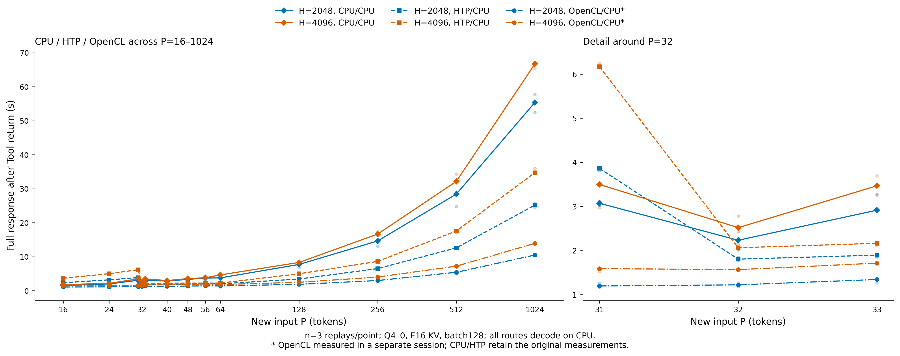
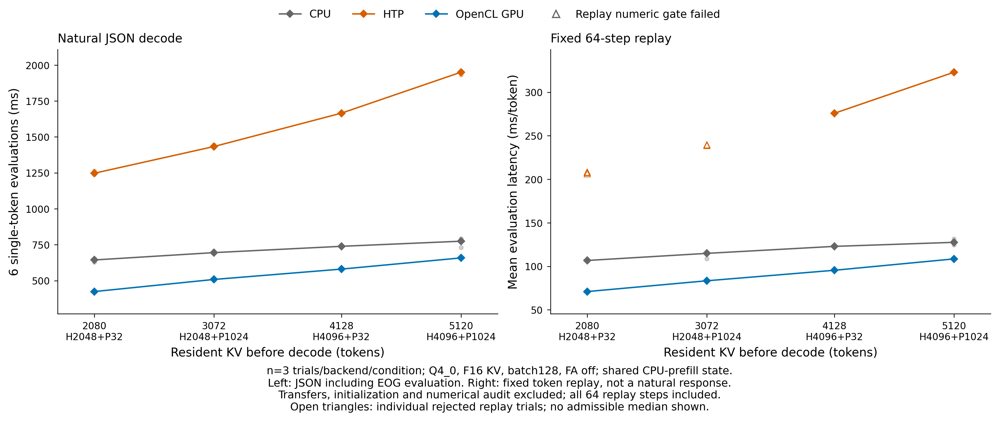

# 独立 GPU/OpenCL 对照归档

本页及其代码和结果仅位于 `codex/gpu-opencl-study` 分支，不合入 `main`。主线继续限定于 CPU/HTP 与 Tool Gap 状态准备的窄范围；本对照不作为主线默认候选后端或后续结论。

## Prefill 与完整响应

[实验口径和完整记录](gpu-study/prefill/README.md)。第一张曲线为同一模型、H2048/4096、13个P点的CPU/CPU、HTP/CPU、OpenCL/CPU完整响应。OpenCL独立会话补测，234条记录通过，26个条件观测中位数均最低；不是跨会话最优性证明。

[矢量PDF](gpu-study/prefill/figures/01_backend_boundary.pdf) · [逐点CSV](gpu-study/prefill/figures/boundary.csv)

## Decode

[实验口径和完整记录](gpu-study/decode/README.md)。同一进程中从相同CPU prefill快照出发，比较四个H/P条件的6次单token评估与64步固定回放。52条记录、36次正式重复；短JSON和迁移全部通过，长回放10/12条件组准入。

HTP H2048/P32、P1024的64步回放最低cosine为0.989187、0.988229，低于0.99；按整组排除有效中位数，图上只保留空心原始点。`completion.passed=false`明确保留，完成采样不等于全部数值通过。自然短JSON未失败。OpenCL回放为71–109ms/token，CPU为107–128ms/token；单会话顺序执行，不推广成通用最优结论。

[矢量PDF](gpu-study/decode/figures/decode_backends.pdf) · [逐点CSV](gpu-study/decode/figures/decode-summary.csv) · [逐步CSV（含准入标志）](gpu-study/decode/figures/decode-traces.csv)

## 原始证据与复现

[原始证据压缩包](gpu-study/raw-evidence.tar.gz)包含原CPU/HTP曲线、GPU正式补测、预检和失败轮的manifest、原始JSONL与日志；[SHA256目录](gpu-study/evidence-manifest.json)标识所有文件。`results/`继续保持本地不入库规则；此处仅归档可审阅的紧凑结果与证据，不复制模型、运行库、agent二进制或KV大资产。

复现入口为 `scripts/profile/opencl_boundary_campaign.py` 与 `scripts/profile/decode.py`，使用 `configs/opencl-boundary-*-termux.json` 和 `configs/decode-backends-termux.json`。先通过工程现有NDK入口构建agent，运行库/模型继续复用shared及手机已有安装。新机器需按记录恢复相应历史/输入夹具路径；当前报告中的原始绝对路径仅用于追溯原会话。
